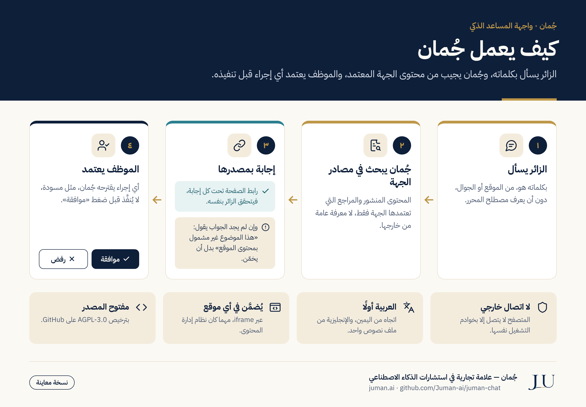
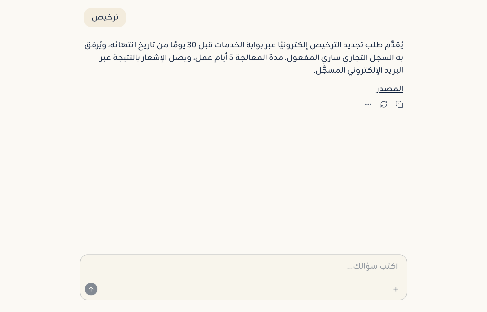
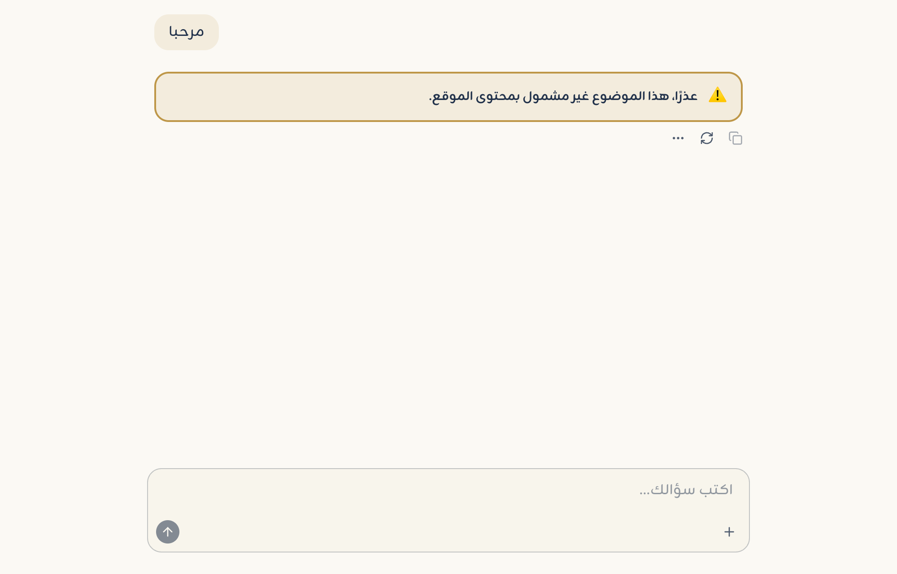
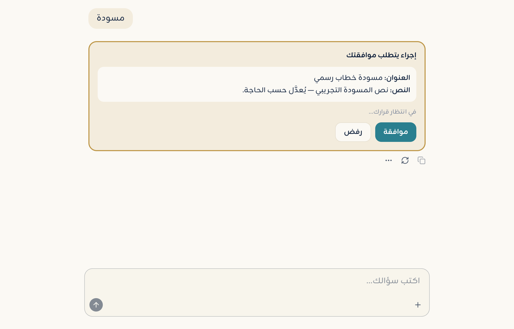
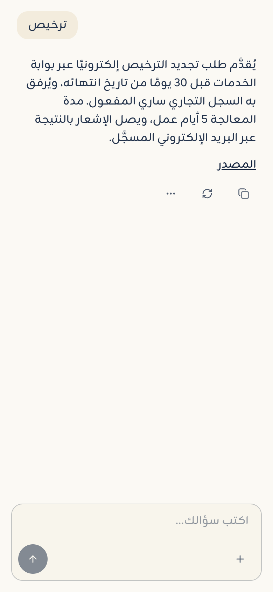
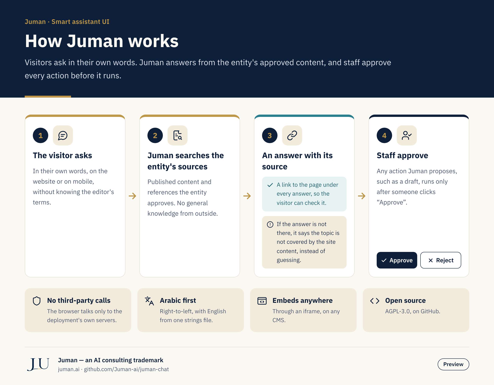
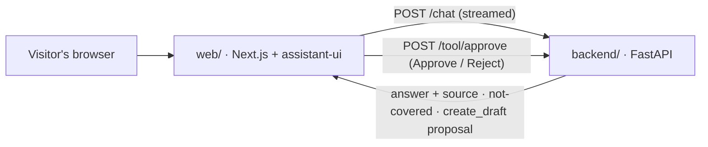

<p align="center">
  
</p>

<p align="center">
  <a href="#ar">العربية</a> · <a href="#en">English</a>
</p>

<a id="ar"></a>

<div dir="rtl">

# جُمان — واجهة المساعد الذكي

واجهة محادثة عربية لمساعد يجيب الزائر من محتوى الجهة المعتمد، ويذكر مصدر كل إجابة، ولا ينفّذ أي إجراء قبل موافقة الموظف.

> **الحالة: نسخة معاينة.** الخادم في هذا المستودع تجريبي، يعيد إجابات ثابتة لعرض الواجهة. ربط الواجهة بمحتوى الجهة وبنموذج اللغة يكون في نواة جُمان.

## لماذا جُمان

الزائر يبحث بكلماته هو، والموقع لا يعرف إلا كلمات المحرر، فيُضطر للتواصل ليسأل عمّا هو منشور أصلًا. جُمان يجيب الزائر من المحتوى المعتمد نفسه، بكلمات الجهة كما نشرتها، ويذكر رابط الصفحة تحت كل إجابة.

## ماذا ترى في الواجهة

| إجابة بمصدرها | «غير مشمول بالمحتوى» |
|---|---|
|  |  |
| رابط الصفحة تحت كل إجابة، فيتحقق الزائر بنفسه. | حين لا يجد الجواب في المصادر يقول ذلك بوضوح، بدل أن يخمّن. |

| الموظف يعتمد | على الجوال |
|---|---|
|  |  |
| أي إجراء يقترحه جُمان يظهر بطاقة موافقة. والخادم يرفض التنفيذ دون موافقة صريحة على الإجراء نفسه. | اتجاه من اليمين، وأزرار لمس بحجم 44 بكسل. |

## جرّب الواجهة

بعد التشغيل (الأوامر في [قسم Running](#running))، اكتب في المحادثة:

- **ترخيص** ← إجابة مع رابط المصدر.
- **مسودة** ← بطاقة موافقة على إنشاء مسودة.
- **أي سؤال آخر** ← حالة «غير مشمول بالمحتوى».

## ما يميّز الواجهة

- **لا اتصال خارجي:** المتصفح لا يتصل إلا بخوادم التشغيل نفسها. فُحصت الشبكة على نسخة الإنتاج، ولم يظهر أي طلب لجهة خارجية.
- **العربية أولًا:** اتجاه من اليمين، والنصوص العربية والإنجليزية في ملف واحد `web/lib/strings.ts`.
- **يُضمَّن في أي موقع:** عبر iframe، مهما كان نظام إدارة المحتوى.
- **الهوية في ملف واحد:** ألوان جُمان وخطوطها في `web/app/juman-theme.css`، وتغييرها لا يمس المكونات.

## المكوّنات

- **الواجهة:** Next.js وReact و[assistant-ui](https://github.com/assistant-ui/assistant-ui) وTailwind CSS.
- **الخادم التجريبي:** Python وFastAPI.

## حدود نسخة المعاينة

- الموافقة غير مربوطة بمستخدم مصادَق بعد.
- الإجراءات المعلّقة محفوظة في الذاكرة، وتضيع عند إعادة التشغيل.
- الخطوط تُنزَّل من Google وقت البناء، ويلزم استضافتها محليًا للبناء دون إنترنت.
- ارتفاع الإطار (iframe) ثابت.

## الترخيص والدعم

الكود بترخيص AGPL-3.0-or-later، ومكونات assistant-ui وshadcn/ui المنسوخة بترخيص MIT (انظر [NOTICE](NOTICE)). اسم «جُمان» وشعارها علامة تجارية مسجلة وغير مشمولة بالترخيص (انظر [TRADEMARKS.md](TRADEMARKS.md)).

للدعم: support@juman.ai · [juman.ai](https://juman.ai) · [Issues](https://github.com/Juman-ai/juman-chat/issues). وللبلاغات الأمنية: [SECURITY.md](SECURITY.md).

</div>

---

<a id="en"></a>

<p align="center">
  
</p>

# Juman — Smart Assistant UI

An Arabic-first chat interface for an assistant that answers visitors from the entity's approved content, cites the source of every answer, and runs no action until a staff member approves it.

> **Status: Preview.** The backend in this repository is a demo that returns canned answers to show the interface. Connecting to an entity's content and to a language model happens in the Juman core.

## Why Juman

Visitors search in their own words, while the site only knows the editor's words, so they end up calling to ask about something that is already published. Juman answers from the approved content itself, in the entity's own wording, with a link to the source page under every answer.

## What you see

| An answer with its source | "Not covered" |
|---|---|
|  |  |
| A link to the page under every answer, so the visitor can check it. | When the sources have no answer, it says so instead of guessing. |

| Staff approve | On mobile |
|---|---|
|  |  |
| Any action Juman proposes appears as an approval card. The backend refuses to run it without an explicit approval for that exact action. | Right-to-left, with 44 px touch targets. |

## Try it

After [running](#running) both parts, type in the chat:

- **ترخيص** (licence) → an answer with a source link.
- **مسودة** (draft) → an approval card for creating a draft.
- **anything else** → the "not covered" state.

## Highlights

- **No third-party calls:** the browser talks only to the deployment's own servers. A runtime capture on the production build showed no external requests.
- **Arabic first:** right-to-left, with Arabic and English strings in one file, `web/lib/strings.ts`.
- **Embeds anywhere:** through an iframe, on any CMS.
- **Brand in one file:** Juman colours and fonts live in `web/app/juman-theme.css`; changing them does not touch components.

## Architecture



The backend keeps each proposed action with an id and status `pending`. It runs the action only when `/tool/approve` receives an approval for that id; unknown ids are refused (404) and repeated decisions are refused (409).

## Running

### Backend

```bash
cd backend
python -m venv .venv
source .venv/bin/activate
pip install -r requirements.txt
uvicorn main:app --reload
```

The backend listens on `http://localhost:8000`. Set `JUMAN_ALLOWED_ORIGINS` to a comma-separated list of allowed CORS origins (default: `http://localhost:3000`).

### Frontend

```bash
cd web
cp .env.example .env.local   # set NEXT_PUBLIC_JUMAN_API_URL if the backend is elsewhere
npm ci
npm run build
npm start
```

| Variable | Default | Purpose |
|---|---|---|
| `NEXT_PUBLIC_JUMAN_API_URL` | `http://localhost:8000` | Backend API URL |
| `NEXT_PUBLIC_ENABLE_ATTACHMENTS` | _(unset = hidden)_ | Set to `true` to show the file-attach button |

The frontend runs on `http://localhost:3000`. To test embedding, open `http://localhost:3000/iframe-test.html`.

## Project structure

```
backend/                 Demo API (FastAPI): /chat and /tool/approve
web/app/                 Page, layout, runtime adapter, brand layer (juman-theme.css)
web/components/juman/    Juman components: approval card, "not covered" card
web/components/assistant-ui/, web/components/ui/   Copied MIT components (see NOTICE)
web/lib/strings.ts       Arabic and English UI strings
docs/images/             Infographics and screenshots
```

## Known limitations (preview)

- Approval is not bound to an authenticated user yet.
- Pending actions are kept in memory and are lost on restart.
- Fonts are fetched from Google at build time; self-host them for offline builds.
- The iframe height is fixed.

## License and support

AGPL-3.0-or-later. The copied assistant-ui and shadcn/ui components are MIT (see [NOTICE](NOTICE)). The name "جُمان / Juman" and its logo are registered trademarks and are not licensed (see [TRADEMARKS.md](TRADEMARKS.md)).

Contributions need a DCO sign-off ([CONTRIBUTING.md](CONTRIBUTING.md)). Support: support@juman.ai · [juman.ai](https://juman.ai) · [Issues](https://github.com/Juman-ai/juman-chat/issues). Security reports: [SECURITY.md](SECURITY.md).
